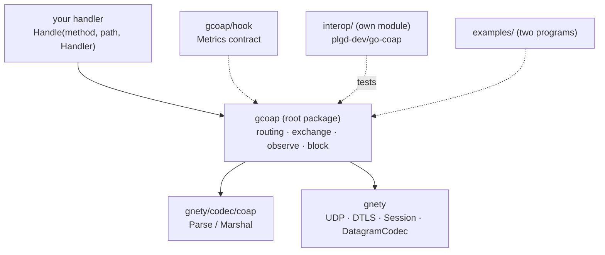
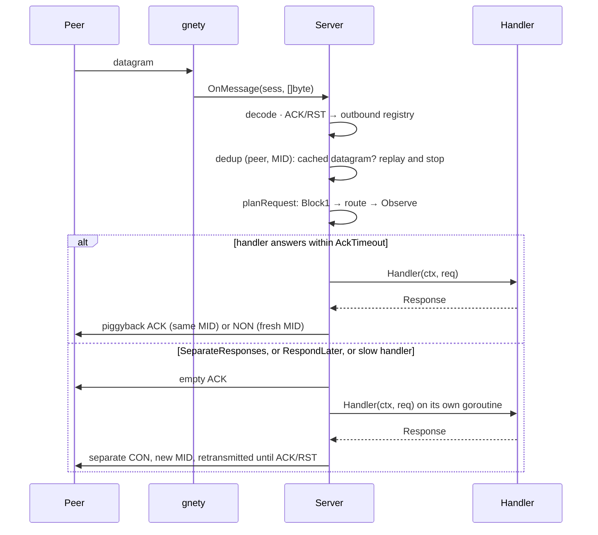

English | [简体中文](ARCHITECTURE.zh-CN.md)

# Architecture: one package, three layers

> Applies to the current tree (2026-11-04). The platform repository's
> `docs/design/libs.md` and `docs/design/dependency-rules.md` hold the rules behind
> the split; this document is the package-level map for this repository.

gcoap is a CoAP state machine on top of [gnety](https://github.com/maxid/gnety).
gnety owns the datagram — sockets, DTLS, sessions and the byte-level codec boundary.
gcoap owns everything that turns those datagrams into CoAP: message types and ids,
exchange state, retransmission, deduplication, routing, observation, block-wise
transfer and separate responses. Nothing here knows about another protocol library.

- gnety hands gcoap a `[]byte` and a `*gnety.Session` to write to. gcoap never holds a
  `net.PacketConn`, never parses an IP address and never touches TLS material.
- `MessageCodec` (`codec.go`) is the adapter to gnety's `DatagramCodec`: `Decode` is
  `coap.Parse`, `Encode` returns a `coap.Message` marshalled — or a `[]byte` unchanged.
  The raw-bytes case is not a shortcut: the deduplication cache and the separate-response
  path replay a datagram **byte for byte**, and re-encoding would change the message id.
- Wire rules (option ordering, critical options, token encoding) live in
  `gnety/codec/coap`. gcoap never assembles bytes.

## Where the code lives

| File | Responsibility |
|---|---|
| `server.go` | `Config`, server lifecycle (`New`/`Start`/`Stop`/`Addr`), the route table (exact + longest prefix), `onMessage` (ACK/RST dispatch, dedup gate, response shaping), handler contexts |
| `exchange.go` | RFC 7252 §4.8 parameters, the retransmission schedule and jitter, peer identity, the bounded deduplication cache |
| `separate.go` | One inbound request end to end: `planRequest` (Block1 → route → observe), the ACK timer, `RespondLater`, the separate-response delivery, response finalization |
| `outbound.go` | Registry for server-sent confirmable messages (notifications, separate responses) and the ACK/RST correlation by message id |
| `observe.go` | The server-side observer table, `Notify`, the per-observer notification loop, session-close cleanup |
| `block.go` | The bounded Block1 assembler, the completed-response cache, Block2 slicing |
| `client.go` | `Dial`/`DialConfig`, `Do`, the reader goroutine, demultiplexing, Block2 assembly, client metrics |
| `client_block.go` | Block1 upload |
| `client_observe.go` | The client `Observation` lifecycle, freshness rule, deregistration |
| `codec.go` | The `DatagramCodec` adapter described above |
| `hook/` | The `Metrics` contract and its label constants; imported by the root package as aliases (`hook.go`) |
| `interop/` | A separate Go module with the interoperability tests against `plgd-dev/go-coap/v3` |
| `examples/` | Two runnable programs; nothing imports them |

There is one package, not several, because the parts share the exchange object and its
locks; splitting them would only add indirection. `hook/` is separate so a custom metrics
implementation does not import the engine it measures.

## Server: one read loop, two execution modes

- **Handler placement.** By default a handler runs on the transport read loop. A handler
  that blocks therefore stalls every peer on that socket — with one UDP listener that is
  all peers. `Config.SeparateResponses` detaches each confirmable request onto its own
  goroutine and requires handlers to be safe for concurrent calls.
- **Handler context.** It is cancelled when the handler returns, when its session closes
  and when the server stops. Work that outlives the handler must use
  `Request.RespondLater()`: the empty ACK goes out immediately and the context stays alive
  until the responder sends the answer, the session closes or the server stops. A caller
  that constructs a `Request` itself has no exchange and gets `ErrResponseAlreadySent`.
- **Locks.** `Server.mu` guards the route table, `hMu` the base context and the per-session
  handler cancelers, `obsMu` the observer table *and* the per-observer notification state,
  `outMu` the outbound registry, `blockMu` the Block1 state, `dedupCache.mu` the cache.
  The order is: no lock is held while a handler runs or while `Metrics` is called.
- **Stop.** It cancels in-flight handler contexts first, so a slow handler cannot delay
  shutdown, then clears the dedup cache and the Block1 state and stops the listener.

## Client: one reader, token demultiplexing

`DialConfig` starts exactly one reader goroutine. Each datagram is routed by:

1. an empty ACK or a RST → by message id (`requestsByID`), because those carry no token;
2. anything else → by token, first the request exchanges, then the observations.

An exchange wins over an observation, so the response to a registration or deregistration
request is never mistaken for a notification. `Client.Do` is safe for concurrent use:
every call owns a 4-byte crypto-random token and a message id that avoids in-flight
exchanges, so responses never cross between callers. A request body larger than
`ClientConfig.BlockSize` becomes a Block1 upload, and a Block2 response is assembled before
`Do` returns.

`Close` stops the reader, fails the pending exchanges with `ErrClientClosed` and ends every
observation without deregistering (there is nobody left to tell).

## Exchange layer: timers and deduplication

Both sides follow RFC 7252 §4.2/§4.8 with the same parameters:

| Parameter | Default | Used for |
|---|---|---|
| `AckTimeout` (ACK_TIMEOUT) | 2s | first retransmission interval |
| `AckRandomFactor` (ACK_RANDOM_FACTOR) | 1.5 | jitter in `[1, 1.5)` |
| `MaxRetransmit` (MAX_RETRANSMIT) | 4 | retransmissions of one CON message |
| `ExchangeLifetime` (EXCHANGE_LIFETIME) | 247s | upper bound of one exchange and of one dedup entry |
| `MaxExchanges` | 1024 | inbound dedup cache size |

The wait before retransmission number *n* is `AckTimeout << n` times a jitter factor
drawn **once per exchange**, truncated by the remaining exchange lifetime. A negative
`MaxRetransmit` sends once and never retransmits.

The dedup cache is keyed by *peer identity* — session id plus remote address — and message
id, so a new DTLS handshake or a NAT rebind cannot replay another session's cache. It
replays the exact bytes it stored: either the final response or the interim empty ACK,
which is marked as such and never promoted to a final response. A non-confirmable request
is **not** deduplicated: nothing acknowledges it, so a repeat is a new request by
definition.

## Observation (RFC 7641)

Server side:

- **Registration.** A `GET` with `Observe=0` on a registered route creates an observer
  keyed by `(session, token)` under its path, and the handler's `2.xx` response gains the
  `Observe` option — it *is* the first notification. `Config.MaxObservers` (256) bounds the
  table; one registration beyond it is answered `5.03 Service Unavailable` instead of
  evicting somebody else.
- **Notification.** `Server.Notify(path, resp)` increments a per-observer sequence number
  and sends. By default notifications are non-confirmable and sent synchronously. With
  `Config.ConfirmableNotifications` each notification is a CON with a fresh message id,
  retransmitted by a background goroutine (one per observer and notification). While one is
  unacknowledged, at most one newer notification is kept at a time
  (`MaxNotificationsInFlight = 1`): memory stays bounded and the newest state wins over
  queued stale ones.
- **End.** `GET` with `Observe=1`, a RST in answer to a CON notification, the session
  closing or the server stopping all remove the observer; its notification loop ends with
  the per-observer context.

Client side:

- **Registration.** `Client.Observe` sends `GET` with `Observe=0`, and requires both a
  `2.xx` code and the `Observe` option; otherwise the registration is rejected with
  `ErrObserveRejected`. RFC 7641 §3.2 makes that response the first notification, so it is
  returned rather than handed to the callback.
- **Freshness.** A later notification is delivered only if its sequence number is newer in
  the 24-bit serial arithmetic of RFC 7641 §3.4 (`diff != 0 && diff < 2²³`). A stale
  notification is not delivered, but a confirmable stale one is still ACKed — the peer
  needs the ACK, not our agreement.
- **Callback rules.** The callback runs on the reader goroutine, serially, in arrival
  order, while the observation lock is held. It must not block and must not call back into
  the client — a slow consumer has to hand the notification to its own goroutine or a
  buffered channel, as `examples/observe-client` does. `Observation.Cancel` therefore cannot
  run from inside the callback.
- **End.** `Cancel` sends `Observe=1` as a CON and waits for the answer; cancelling the
  context sends a best-effort non-confirmable deregistration; a final `4.xx`/`5.xx`
  notification from the server ends the observation; `Client.Close` ends all of them.

## Block-wise transfer (RFC 7959)

**Block2, server.** A `GET` response larger than `Config.BlockSize` (1024) is sliced even
when the request carried no Block2 option, so a body larger than the MTU is deliverable.
An out-of-range block number is `4.00 Bad Request`.

**Block2, client.** `Do` follows `More=1` blocks with the same token and a new message id
until the body is complete, and stops with `ErrResponseTooLarge` beyond
`ClientConfig.MaxResponseSize` (1 MiB). There is no ETag or representation snapshot: a
resource that changes during the sequence can be spliced together from two states.

**Block1, client.** A request body larger than `BlockSize` is uploaded in blocks, starting
at block 0 with the size the client picked and `Size1` announced. The client expects
`2.31 Continue`, adopts a *smaller* block size when the server answers with one, and
returns an early final or error response instead of continuing.

**Block1, server.** State is keyed by `(session, token)` and bounded by
`Config.MaxBlockUploads` (128 in flight), `Config.MaxBlockPayload` (1 MiB per body, also
checked against a declared `Size1`) and `Config.BlockIdleTimeout` (60s). A block that
changes the method, URI or block size, or arrives out of order, is `4.08 Request Entity
Incomplete`; an over-limit body `4.13 Request Entity Too Large`; a new upload beyond the
limit `5.03 Service Unavailable`. A repeated block replays `2.31` without appending the
body twice, and the cached final response is replayed when the last block is repeated with
a new message id — which is what a client retransmission looks like after its ACK was lost.

## Limits and defaults

| Config field | Default | Meaning |
|---|---|---|
| `Config.MaxObservers` | 256 | observers across all resources |
| `Config.MaxBlockUploads` | 128 | Block1 uploads in progress |
| `Config.MaxBlockPayload` | 1 MiB | body of one Block1 upload |
| `Config.BlockIdleTimeout` | 60s | idle upload and completed-response expiry |
| `Config.BlockSize` | 1024 | Block2 slice size |
| `Config.MaxExchanges` | 1024 | dedup cache entries |
| `ClientConfig.BlockSize` | 1024 | Block1 chunk size (16…1024) |
| `ClientConfig.MaxRequestSize` | 1 MiB | request body limit |
| `ClientConfig.MaxResponseSize` | 1 MiB | assembled Block2 body limit |

Every limit is **global**, not per peer: one peer can consume the whole observer or upload
budget. Per-peer quotas are tracked in `../ROADMAP.md`.

## Observability

`hook.Metrics` (re-exported by the root package) receives five low-cardinality events:
`Exchange(method, result, duration)`, `Dedup()`, `Retransmit(kind)`, `Observe(event)` and
`Block(direction, result)`. Labels are method, code class, result and kind only — never a
token, a path or a peer address, because those would make the metric set unbounded. Hooks
are called outside the library's locks and must not block; a nil hook costs nothing and
`NoopMetrics` is the explicit no-op. The full event list is in
[`hook/metrics.go`](../hook/metrics.go).

## How this is verified

| Level | Where | What it proves |
|---|---|---|
| Unit | `*_test.go` next to the code | routing, exchange timers (fake clock in `clock_test.go`), dedup, separate responses, observe, block limits, client concurrency — over real loopback UDP sockets, no transport mocks |
| Fuzz | `codec_fuzz_test.go` | a peer-controlled datagram cannot panic the decoder, makes it allocate beyond the input, or break `encode(decode(x))` idempotency |
| Interop | `interop/` (own module) | both directions against `plgd-dev/go-coap/v3` over UDP and DTLS, including Block1, Block2 and observe |
| Examples | `examples/` | the advertised API compiles and runs, and `-serve` keeps a server an external client can query |
| CI | `.github/workflows/ci.yml` | `test` on three OSes, `race` and a short `fuzz` run on Linux |

## Known gaps

- Per-peer observer and upload quotas (limits are global today) and a weak-network
  fault-injection matrix — both tracked in `../ROADMAP.md`.
- Block2 has no representation snapshot (ETag/If-Match), so a changing resource can be
  spliced mid-sequence.
- `hook.ObserveExpired` and `hook.BlockExpired` are defined but no code path emits them.
- No benchmark and no `PERFORMANCE.md`: the library makes no performance claim yet.
