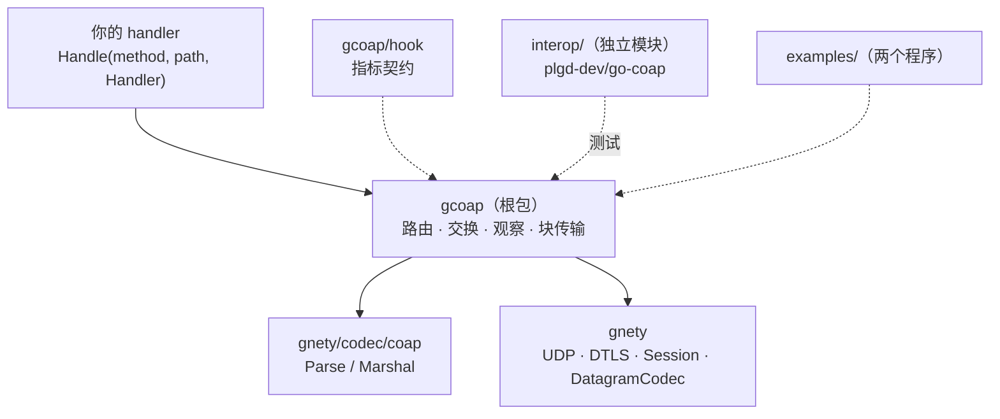
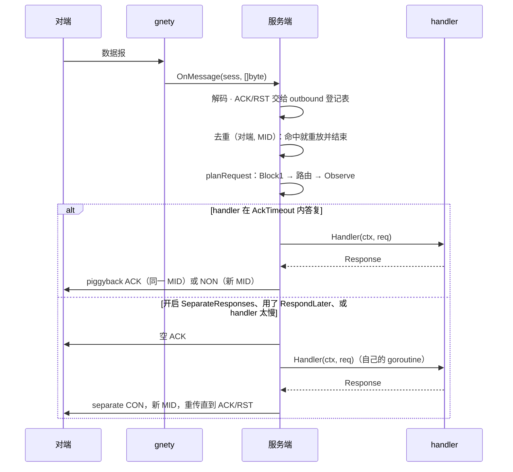

[English](ARCHITECTURE.md) | 简体中文

# 架构：一个包，三层

> 适用于当前代码树（2026-11-04）。分层规则本身写在平台仓库的
> `docs/design/libs.md` 与 `docs/design/dependency-rules.md`；这份文档是本仓库的包级地图。

gcoap 是跑在 [gnety](https://github.com/maxid/gnety) 之上的 CoAP 状态机。gnety 负责数据报本身
——套接字、DTLS、会话和字节级的 codec 边界；gcoap 负责把这些数据报变成 CoAP 的一切：报文类型
与 message id、交换状态、重传、去重、路由、观察、块传输与 separate response。这里不认识任何
其它协议库。

- gnety 交给 gcoap 一个 `[]byte` 和一个可写的 `*gnety.Session`。gcoap 不持有 `net.PacketConn`、
  不解析 IP 地址、不碰 TLS 材料。
- `MessageCodec`（`codec.go`）是 gnety `DatagramCodec` 的适配器：`Decode` 就是 `coap.Parse`，
  `Encode` 既接受 `coap.Message`（marshal 成字节），也接受 `[]byte`（原样写出）。后者不是偷懒：
  去重缓存和 separate response 会**逐字节**重放一个数据报，重新编码会改掉 message id。
- 线格式规则（选项顺序、critical 选项、token 编码）在 `gnety/codec/coap` 里，gcoap 从不自己
  拼字节。

## 代码在哪里

| 文件 | 职责 |
|---|---|
| `server.go` | `Config`、服务端生命周期（`New`/`Start`/`Stop`/`Addr`）、路由表（精确 + 最长前缀）、`onMessage`（ACK/RST 分派、去重闸门、响应成形）、handler 上下文 |
| `exchange.go` | RFC 7252 §4.8 参数、重传时间表与抖动、对端标识、有界去重缓存 |
| `separate.go` | 一个入站请求的完整流程：`planRequest`（Block1 → 路由 → Observe）、ACK 定时器、`RespondLater`、separate response 投递、响应收尾 |
| `outbound.go` | 服务端发出的 confirmable 报文（通知、separate response）登记表，按 message id 关联 ACK/RST |
| `observe.go` | 服务端 observer 表、`Notify`、每个 observer 的通知循环、会话关闭清理 |
| `block.go` | 有界 Block1 组装器、已完成响应缓存、Block2 切片 |
| `client.go` | `Dial`/`DialConfig`、`Do`、读循环 goroutine、分用、Block2 组装、客户端指标 |
| `client_block.go` | Block1 上传 |
| `client_observe.go` | 客户端 `Observation` 生命周期、新鲜度规则、注销 |
| `codec.go` | 上面说的 `DatagramCodec` 适配器 |
| `hook/` | `Metrics` 契约与标签常量；根包以别名重新导出（`hook.go`） |
| `interop/` | 独立 Go 模块，对 `plgd-dev/go-coap/v3` 的互操作测试 |
| `examples/` | 两个可运行程序；库不 import 它们 |

只有一个包而不是多个，是因为这些部件共享同一个交换对象和它的锁，拆开只会多一层间接。
`hook/` 单独成包，是为了让自定义指标实现不必 import 它所测量的引擎。

## 服务端：一个读循环，两种执行模式

- **handler 在哪里跑。** 默认跑在传输读循环上。阻塞的 handler 会卡住这个套接字上的**所有**
  对端 —— UDP 只有一个监听器，也就是全部对端。`Config.SeparateResponses` 会把每个 confirmable
  请求摘到独立 goroutine，此时 handler 必须能安全并发调用。
- **handler 上下文。** handler 返回、其会话关闭、服务端停止时都会取消。比 handler 活得更久的
  工作必须用 `Request.RespondLater()`：空 ACK 立刻发出，上下文一直活到 responder 发出响应、
  会话关闭或服务端停止。自己构造的 `Request` 没有交换，调用它只会得到 `ErrResponseAlreadySent`。
- **锁。** `Server.mu` 管路由表，`hMu` 管基础上下文和按会话登记的 handler cancel，
  `obsMu` 管 observer 表**以及**每个 observer 的通知状态，`outMu` 管 outbound 登记表，
  `blockMu` 管 Block1 状态，`dedupCache.mu` 管去重缓存。约定是：跑 handler 时、调用 `Metrics`
  时都不持锁。
- **Stop。** 先取消在途的 handler 上下文（慢 handler 拖不住关闭），再清空去重缓存和 Block1
  状态，最后停监听器。

## 客户端：一个读 goroutine，按 token 分用

`DialConfig` 只起一个读 goroutine。每个数据报按下面的顺序归位：

1. 空 ACK 或 RST → 按 message id（`requestsByID`），因为这两种报文不带 token；
2. 其它 → 按 token，先找请求交换，再找观察。

交换优先于观察，所以注册/注销请求的响应永远不会被当成通知。`Client.Do` 并发安全：每次调用
持有自己的 4 字节随机 token 和一个避让在途交换的 message id，响应不会串到别的调用方。请求体
大于 `ClientConfig.BlockSize` 时自动变成 Block1 上传，Block2 响应在 `Do` 返回前组装完毕。

`Close` 停掉读 goroutine、让在途交换以 `ErrClientClosed` 失败，并结束所有观察（不再注销 ——
已经没人可通知了）。

## 交换层：定时器与去重

两侧都按 RFC 7252 §4.2/§4.8，参数相同：

| 参数 | 默认 | 用途 |
|---|---|---|
| `AckTimeout`（ACK_TIMEOUT） | 2s | 第一次重传的间隔 |
| `AckRandomFactor`（ACK_RANDOM_FACTOR） | 1.5 | `[1, 1.5)` 的抖动 |
| `MaxRetransmit`（MAX_RETRANSMIT） | 4 | 一条 CON 报文的重传次数 |
| `ExchangeLifetime`（EXCHANGE_LIFETIME） | 247s | 单个交换与单条去重项的上界 |
| `MaxExchanges` | 1024 | 入站去重缓存容量 |

第 *n* 次重传前的等待是 `AckTimeout << n` 乘以一个**每个交换只抽一次**的抖动因子，再被剩余的
交换生命周期截断。`MaxRetransmit` 为负表示只发一次、永不重传。

去重缓存的键是*对端标识*（会话 id + 对端地址）加 message id，所以一次新的 DTLS 握手或 NAT
重绑定无法重放别的会话的缓存。它重放的是当时存下的确切字节：要么是最终响应，要么是标记为
interim 的空 ACK（永远不会被当成最终响应）。non-confirmable 请求**不**去重：没有人 ACK 它，
重复发送按定义就是新请求。

## 观察（RFC 7641）

服务端：

- **注册。** 已注册路由上的 `GET` 带 `Observe=0` 时，按 `(会话, token)` 在该路径下建一个
  observer，handler 的 `2.xx` 响应挂上 `Observe` 选项 —— 它**就是**第一条通知。
  `Config.MaxObservers`（256）限制整张表，超出时新注册回 `5.03 Service Unavailable`，不去
  顶掉别人。
- **通知。** `Server.Notify(path, resp)` 递增每个 observer 的序号并发送。默认通知是
  non-confirmable、同步发出。开启 `Config.ConfirmableNotifications` 后每条通知是一个新 MID 的
  CON，由后台 goroutine 重传（每个 observer、每条通知一个）。当上一条还没被 ACK 时，最多只保留
  一条更新的通知（`MaxNotificationsInFlight = 1`）：内存有界，并且新状态覆盖排队中的旧状态。
- **结束。** 带 `Observe=1` 的 `GET`、对 CON 通知回 RST、会话关闭、服务端停止，都会移除
  observer；它的通知循环随该 observer 的上下文一起结束。

客户端：

- **注册。** `Client.Observe` 发送带 `Observe=0` 的 `GET`，要求响应既是 `2.xx` 又带 `Observe`
  选项，否则以 `ErrObserveRejected` 拒绝。RFC 7641 §3.2 规定注册响应就是第一条通知，所以它作为
  返回值给出，而不是塞进回调。
- **新鲜度。** 后续通知按 RFC 7641 §3.4 的 24 位序号算术判断更新才投递
  （`diff != 0 && diff < 2²³`）。过期的通知不投递，但 confirmable 的过期通知仍然要 ACK ——
  对端需要的是 ACK，不是我们的认同。
- **回调规则。** 回调跑在读 goroutine 上，按到达顺序串行，并且持着该观察的锁。它不能阻塞、
  不能回调进客户端 —— 慢消费者要把通知交给自己的 goroutine 或带缓冲的 channel，就像
  `examples/observe-client` 那样。因此 `Observation.Cancel` 不能在回调里调用。
- **结束。** `Cancel` 用 CON 发 `Observe=1` 并等答复；取消上下文只发尽力而为的
  non-confirmable 注销；服务端发来的最终 `4.xx`/`5.xx` 通知会结束观察；`Client.Close` 结束
  全部观察。

## 块传输（RFC 7959）

**Block2，服务端。** 大于 `Config.BlockSize`（1024）的 `GET` 响应即使请求没带 Block2 选项也会
切片，超过 MTU 的响应因此可送达。块号越界回 `4.00 Bad Request`。

**Block2，客户端。** `Do` 用同一个 token、每条新 message id 跟随 `More=1` 的块直到组装完成，
超过 `ClientConfig.MaxResponseSize`（1 MiB）时以 `ErrResponseTooLarge` 停止。没有 ETag 或
表示快照：序列进行中变化的资源可能被拼成两个状态的混合。

**Block1，客户端。** 大于 `BlockSize` 的请求体分块上传，从块 0 开始、声明 `Size1`。客户端期望
`2.31 Continue`，服务端给出更小的块大小时只接受更小的那个，收到提前的最终响应或错误响应就
直接返回、不再继续。

**Block1，服务端。** 状态以 `(会话, token)` 为键，受 `Config.MaxBlockUploads`（128 个在途）、
`Config.MaxBlockPayload`（单个 1 MiB，同时校验声明的 `Size1`）与 `Config.BlockIdleTimeout`
（60s）约束。改变 method、URI 或块大小，或乱序到达的块回 `4.08 Request Entity Incomplete`；
超限的体回 `4.13 Request Entity Too Large`；超过在途上限的新上传回 `5.03 Service Unavailable`。
重复的块重放 `2.31` 且不重复追加；最后一块以新 message id 重发时（客户端 ACK 丢失后的重传就
长这样）重放缓存的最终响应。

## 限额与默认值

| 配置项 | 默认 | 含义 |
|---|---|---|
| `Config.MaxObservers` | 256 | 全部资源的 observer 总数 |
| `Config.MaxBlockUploads` | 128 | 在途 Block1 上传数 |
| `Config.MaxBlockPayload` | 1 MiB | 单个 Block1 上传的体 |
| `Config.BlockIdleTimeout` | 60s | 空闲上传与已完成响应的过期 |
| `Config.BlockSize` | 1024 | Block2 切片大小 |
| `Config.MaxExchanges` | 1024 | 去重缓存条目数 |
| `ClientConfig.BlockSize` | 1024 | Block1 分块大小（16…1024） |
| `ClientConfig.MaxRequestSize` | 1 MiB | 请求体上限 |
| `ClientConfig.MaxResponseSize` | 1 MiB | Block2 组装上限 |

所有限额都是**全局**的，不是 per-peer：一个对端就能吃掉全部 observer 或上传预算。per-peer
配额记在 `../ROADMAP.md` 里。

## 可观测性

`hook.Metrics`（根包重新导出）接收五种低基数事件：`Exchange(method, result, duration)`、
`Dedup()`、`Retransmit(kind)`、`Observe(event)`、`Block(direction, result)`。标签只有 method、
响应码类别、result 和 kind —— 永远不带 token、路径或对端地址，否则指标集合会无界。钩子在库的
锁之外调用，且不得阻塞；nil 钩子零成本，`NoopMetrics` 是显式空实现。完整事件列表见
[`hook/metrics.go`](../hook/metrics.go)。

## 怎么验证

| 层次 | 位置 | 证明了什么 |
|---|---|---|
| 单元 | 与代码同目录的 `*_test.go` | 路由、交换定时器（`clock_test.go` 的假时钟）、去重、separate response、观察、块传输限额、客户端并发 —— 跑在真实回环 UDP 套接字上，不 mock 传输层 |
| Fuzz | `codec_fuzz_test.go` | 对端可控的数据报不会让解码器 panic、不会做出超过输入规模的分配、不会破坏 `encode(decode(x))` 的幂等性 |
| 互操作 | `interop/`（独立模块） | 对 `plgd-dev/go-coap/v3` 的双向互通，UDP 与 DTLS，含 Block1、Block2 与观察 |
| 示例 | `examples/` | 文档里给出的 API 能编译能跑，`-serve` 留下一个外部客户端可查询的服务端 |
| 基准 | `benchmark_test.go` | 回环 UDP 上一次往返、一次 Block2 下载、一条通知的代价；手工运行，数字记在 `PERFORMANCE.md` |
| CI | `.github/workflows/ci.yml` | 三个 OS 的 `test`，Linux 上的 `race` 与短时 `fuzz` |

## 已知差距

- per-peer 的 observer 与上传配额（现在限额是全局的）、弱网故障注入矩阵 —— 都记在 `../ROADMAP.md`。
- Block2 没有表示快照（ETag/If-Match），变化的资源可能在序列中途被拼接。
- `hook.ObserveExpired` 与 `hook.BlockExpired` 已定义，但没有代码路径发出它们。
- `PERFORMANCE.md` 里的数字只是一台笔记本上的回环基线：不对真实网络或网关做承诺，每次请求的
  分配也没有优化。
